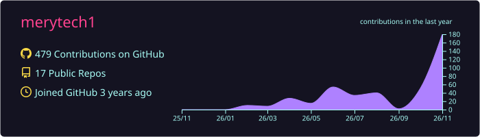
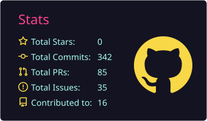
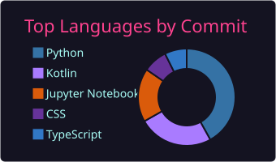
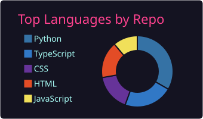
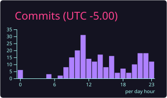

<!-- Banner -->

  

<!-- Typing SVG -->

  

<!-- Contacto -->

  
  
  <!-- TODO: reemplazar el enlace cuando el portafolio esté publicado (p. ej. https://merytech1.github.io) -->
  
  

---

## 👩‍💻 Sobre mí

- 💼 Full Stack Developer: construyo aplicaciones web de punta a punta, desde la interfaz hasta la API y la base de datos.
- 🔭 Actualmente trabajo en **[tvshields](https://github.com/merytech1/tvshields)**, un navegador ligero para Android TV con bloqueo de anuncios al estilo Brave.
- 🌱 Sigo aprendiendo sobre **machine learning** y **desarrollo Android con Kotlin**.
- 🤝 Me interesa colaborar en proyectos **open source** y productos con enfoque en la **privacidad**.
- 💬 Pregúntame sobre **React, TypeScript, Python y FastAPI**.
- 📫 Escríbeme a **meriyei.manfer@gmail.com**.

🌎 <b>About me (English)</b>

 

- 💼 Full Stack Developer: I build web applications end to end, from the UI to the API and the database.
- 🔭 Currently working on **[tvshields](https://github.com/merytech1/tvshields)**, a lightweight Android TV browser with Brave-style ad blocking.
- 🌱 Learning more about **machine learning** and **Android development with Kotlin**.
- 🤝 Open to collaborating on **open source** and **privacy-first** products.
- 💬 Ask me about **React, TypeScript, Python and FastAPI**.
- 📫 Reach me at **meriyei.manfer@gmail.com**.

---

## 🛠️ Tech Stack

### 🎨 Frontend

  
  
  
  
  
  

### ⚙️ Backend

  
  
  
  
  
  
  
  

### 🧰 DevOps y herramientas · Tools

  
  
  
  
  
  
  

---

## 🚀 Proyecto destacado · Featured project

### 📺 [tvshields](https://github.com/merytech1/tvshields)

Navegador open source y ligero para **Android TV** con protección al estilo Brave Shields: bloqueo de anuncios a nivel de red con listas de filtros, filtrado cosmético y reemplazo de scripts anti-adblock. Pensado para usarse con el control remoto.

🇬🇧 Lightweight open-source Android TV browser with Brave-style Shields: network ad blocking, cosmetic filtering and anti-adblock script replacement. Built for the TV remote.

  
  
  
  

---

## 📊 Estadísticas · GitHub Stats

<!-- Generated daily by .github/workflows/profile-summary-cards.yml -->

  

  
  

  
  

  

---

<!-- Footer -->

  <i>✨ Gracias por pasar por aquí · Thanks for stopping by ✨</i>

  

